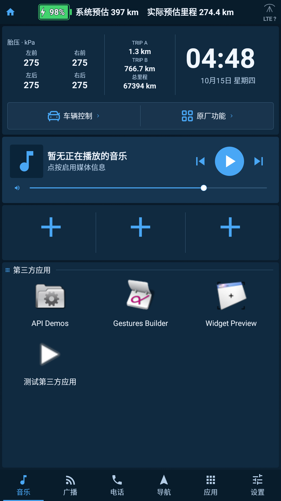

# 威马桌面 · WM Launcher

**为 Android 6.0.1 车机设计的轻量桌面：功能精简，安装包约 1.30 MiB。**

把应用、音乐和车辆信息放到一个清晰的首页，大图标、大字体，支持横屏和竖屏。基于开源 Dashline 适配，不是威马官方软件。

[下载最新版](https://github.com/naojiren/wm-launcher/releases/latest) · [wm26 发布说明](https://github.com/naojiren/wm-launcher/releases/tag/v0.1.0-wm26)

## 小体积，保留常用功能

wm26 独立版 APK 为 **1,363,805 字节，约 1.30 MiB / 1.36 MB**。体积来自实际发布文件，源码包大小不计入 APK。

- **原生界面**：Kotlin + Android Views，使用系统字体和矢量图标。
- **功能精简**：去掉在线天气；音乐、导航等直接调用车机已有应用，不把播放器、地图或浏览器打包进桌面。
- **依赖少**：不依赖 Google Play 服务，无广告 SDK，无在线字体或图标下载。
- **减少后台工作**：车辆信息在桌面前台读取，离开桌面后释放相关监听。

## 日常使用

- 自动识别已安装应用；首页默认显示第三方应用，每排 3 个，完整显示 3 排，更多应用左右翻页。
- 完整应用抽屉按“第三方 / 原厂应用 / 全部”分类；长按可隐藏、打开系统应用详情或发起卸载。
- 保留 3 个自定义快捷入口，以及车辆控制、原厂功能、音乐、广播、电话、导航入口。
- 首页音乐卡片显示曲目和播放状态，提供播放/暂停、上一首、下一首、音量和进度操作。优先使用当前来源支持的直接控制，兼容 CarPlay；已识别的来源拒绝操作时不会转交其他播放器。
- 普通键盘左/右键和桌面按钮控制当前音乐来源。兼容威马实体左右键的原厂专用通知：松开左键上一首，右键下一首；快速连按不会漏掉。原厂播放器保留原厂按键处理，避免重复切歌；离开首页释放监听。
- 深海冰蓝主题、大字和较大的点击区域，适配竖屏与横屏。
- 在兼容的威马固件和权限下，可显示电量、系统预估里程、按 280 × 电量百分比计算的实际预估里程、四轮胎压、TRIP A/B、总里程，以及电池和 LTE 详情。
- Home 使用系统持久首选，开机完成后自动打开威马桌面。启动期间仅短暂检查原厂首页的后续覆盖；用户主动打开应用会取消检查，其他前台应用也不切换。完成后服务停止。威课堂入口与顶部常开设置保留。

## wm26 更新（含 wm24、wm25）

- **一键清理后台**：点击首页左上角小房子，清理第三方后台应用并显示结果。保留桌面、原厂应用、系统服务以及共享系统 UID 的程序；不新增自动清理任务或常驻清理服务。
- **详细参数**：点击时间、日期或指针时钟，查看 13 类车辆和安卓参数。分类菜单自动换成两排或三排，无需横向滑动，页面文字更大。目录包含 259 个读取项目，实际可用项目取决于车型、固件和权限，见 [参数说明](docs/PARAMETERS.md)。
- **充电显示与电量兼容**：绿色电池内显示百分比，充电时增加闪电标志；修正慢充时总充电标志与实际状态不一致的问题。普通安装新增本机 root/ADB 读取电量的备用通道，不使用安卓车机自身的电池数值冒充动力电池电量。
- **蓝牙声音**：检测手机蓝牙媒体连接后，沿用原厂音乐的蓝牙播放路径开启声音。默认开启，在设置中可关闭，每次连接成功后只切换一次。

## 界面预览

下图为 wm26 安卓 6 模拟器的示例数据，仅展示界面，不代表真实车辆读数。



## 安装与兼容

Release 默认提供独立版 **`com.wmhome.launcher`**，适配目标为 Android 6.0.1 / API 23。下载 APK 后在车机安装；同签名覆盖升级可保留桌面配置。

车辆数据依赖对应固件的原厂接口及权限。普通安装也可使用桌面；动力电池电量可借助已授权的本机 root/ADB 通道读取，其余部分车辆数据仍需原厂权限。没有权限或接口未返回有效数值时如实显示不可用，不推算虚假读数。威课堂跳转、默认桌面设置以及开机进入依赖兼容的威马工程权限接口和已授权的本机 ADB/root 通道。

后台清理在已有 root/su 或已授权的本机 root ADB 下，会结束正在运行的第三方应用，包括音乐与 CarPlay 后台服务；强制停止后可点击对应图标重新打开。没有此权限时使用安卓后台进程接口，并显示“已请求清理”，系统可能保留正在使用的服务或重新启动进程。清理过程中离开首页会停止继续强制清理。

TRIP A/B 当前提供显示，尚未接入仪表屏小计清零；系统预估读取原厂值，实际预估按固定 280 km 系数计算。学习强国兼容分支保留在源码中，默认下载使用独立版。

## 自行构建

环境：JDK 21、Android SDK 36、Build Tools 36.0.0。项目使用 Gradle Wrapper 8.13，minSdk / targetSdk 均为 23。首次构建会下载公开构建依赖。

```bash
git clone https://github.com/naojiren/wm-launcher.git
cd wm-launcher
./gradlew :app:assembleLegacyDebug
```

Windows 使用 `gradlew.bat`。调试 APK 位于 `app/build/outputs/apk/legacy/debug/`。

```bash
# Android API 23 单元与布局检查
./gradlew :app:testLegacyDebugUnitTest :app:testXxqgDebugUnitTest

# Release 和静态检查；签名配置独立提供
./gradlew :app:assembleLegacyRelease :app:lintLegacyRelease
```

正式签名可参照 `keystore.properties.example`，或提供 `KEYSTORE_FILE`、`KEYSTORE_PASSWORD`、`KEY_ALIAS`、`KEY_PASSWORD` 环境变量。发布用私钥不包含在仓库中。

wm26 两种发行分支共 **212 项单元/布局检查通过**，lint 无 Error/Fatal；正式 APK 的 v1/v2 签名有效，与旧版沿用同一证书。安卓 6 模拟器完成横竖屏 **36 项界面检查、26 个原生场景**，包含正式包的参数菜单、电量/蓝牙兼容接口以及小房子清理按钮。清理场景检查了第三方前台音乐服务与无入口服务被结束，桌面、原厂和实际系统应用保留，以及离开首页后不继续强制清理。记录见 [wm26-checks.json](docs/wm26-checks.json)。

wm26 已覆盖安装到用户车机；本版清理和蓝牙功能的实际硬件效果仍待用户测试。测试使用专用模拟器和自编服务替身，不能代替真实车辆兼容性验证。保留用户已确认有效的 Home 固定和实体左右切歌，旧版验证记录保留在 docs/。

开机自动进入使用有限启动服务，不进行定时巡检；广播到来前可能短暂出现原厂首页或固件画面。蓝牙声音使用连接事件和有限重试，车辆读数仅在对应页面可见时刷新。正式包不含 debug 仪器入口，车辆原始日志、原厂二进制和发布私钥未公开。

## 开源与致谢

基于 [Dashline](https://github.com/metehankaygsz/dashline)，上游基线 `be4c98fcc649abdec55e687c5e7cda02d9c73001`，原作者 © 2026 Metehan Kaygısız。此适配新增威马车辆信息、原厂入口、应用分类、大字布局、横竖屏适配和精简后的离线首页。

项目遵循 **GPL-3.0-only**，见 [LICENSE](LICENSE)。Release 同时提供对应完整源码包。

图标来自 Tabler Icons（MIT）与 Lucide Icons（完整 ISC / Feather MIT 声明）。固定来源、SVG 原件和完整许可保留在 [third_party](third_party/)，APK 中也附带图标许可。上游说明保留在 [UPSTREAM-README.md](docs/UPSTREAM-README.md)。
